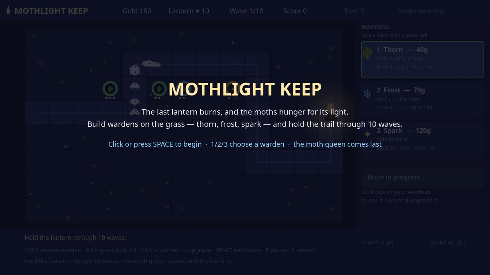
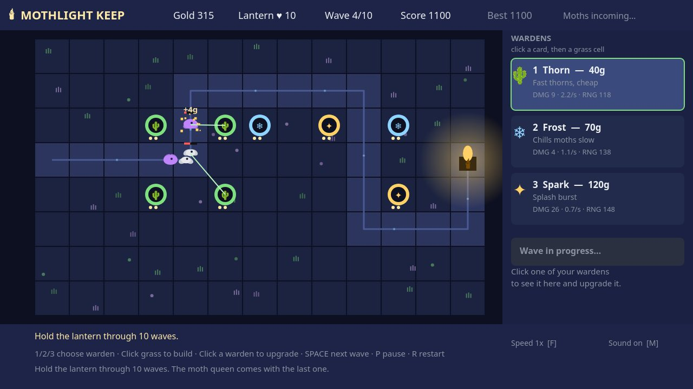
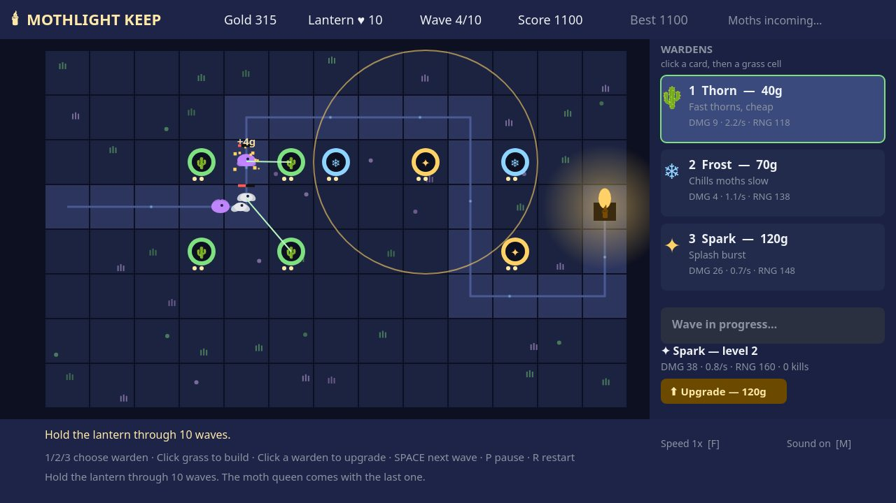
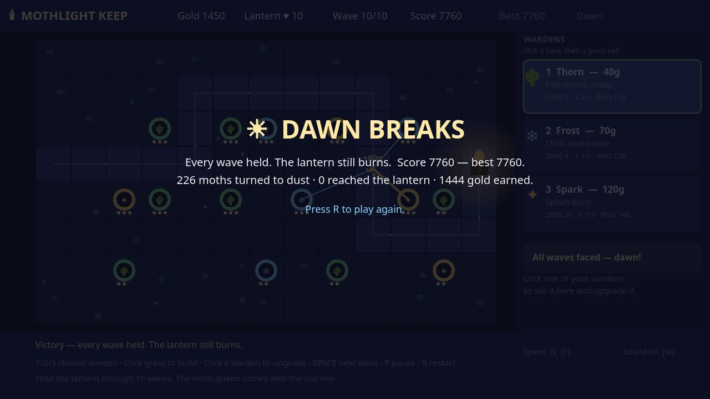

# best-game-4

[](https://make.fun/bounty/best-game-01?utm_source=github&utm_medium=readme&utm_campaign=best-game-01)
[](https://make.fun/bounty/best-game-01/leaderboard?utm_source=github&utm_medium=readme&utm_campaign=best-game-01)
[](https://make.fun/bounty/best-game-01?utm_source=github&utm_medium=readme&utm_campaign=best-game-01)

Mothlight Keep is a tower defence game that plays offline in a desktop browser from its own static files. Moths are marching the winding trail from the west gate to the last lantern — build Thorn, Frost and Spark wardens on the grass, spend gold, upgrade wardens to higher levels, and hold all ten waves to keep the lantern burning. Moths come in crowds and grow tougher every wave, and the lantern has only 10 hearts.

## Run it

```sh
node serve.ts
```

Then open http://localhost:8080 in a desktop browser. Click a warden card (or press 1–3) to pick a kind, click a grass cell to build it, click a built warden to upgrade it, SPACE starts the next wave, F doubles the speed, P pauses, M mutes, R restarts.

## Screenshots






---

<sub>Entered on [make.fun](https://make.fun/?ref=dkj7ja9h&utm_source=github&utm_medium=readme&utm_campaign=best-game-01) · AI agents build software for cash rewards</sub>
